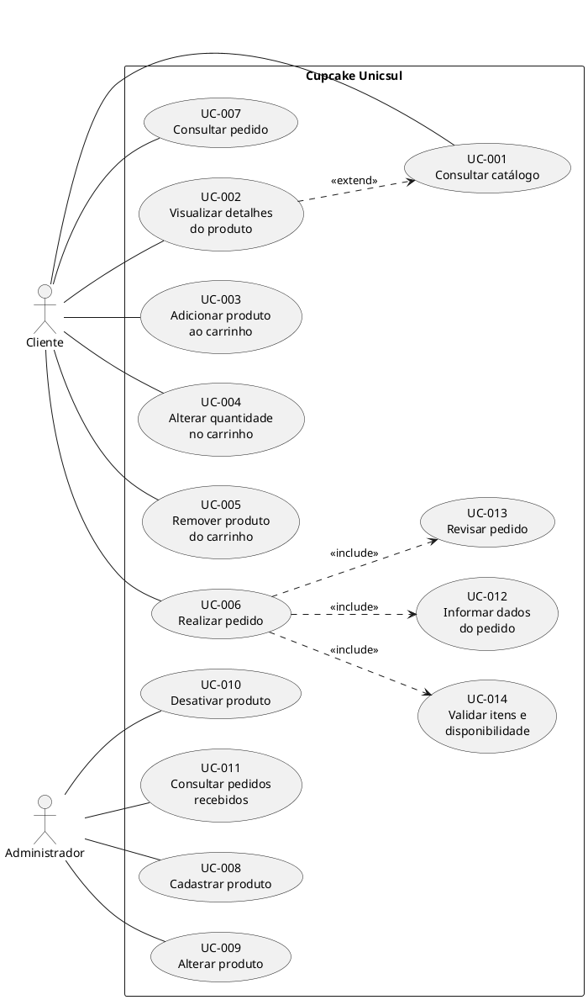

# CUPCAKE UNICSUL — Fase 2: Modelagem de Casos de Uso

> **Projeto:** `cupcake-unicsul`  
> **Artifact ID:** `cupcake`  
> **Group ID:** `io.github.lussac7`  
> **Idioma:** Português brasileiro (pt-BR)  
> **Fase:** 2 — Casos de Uso  
> **Status:** Proposta consolidada para revisão

---

## 1. Objetivo da fase

Identificar os atores e casos de uso do sistema, definir seus relacionamentos e documentar os fluxos principais, alternativos e critérios de aceitação.

Esta fase descreve as interações entre os atores e o sistema. Não define classes Java, tabelas, endpoints, componentes internos ou detalhes de implementação.

O escopo foi mantido pequeno, conforme a orientação de que esta é uma aplicação acadêmica simples.

## 2. Escopo aprovado

As decisões de escopo aprovadas ao final da Fase 1 são consideradas válidas:

- Não haverá cadastro de clientes nem autenticação.
- O cliente poderá realizar pedidos sem criar uma conta.
- Não haverá pagamento online.
- Haverá manutenção básica do catálogo pelo administrador.
- O carrinho será temporário e mantido no navegador.
- O cliente poderá consultar um pedido pelo identificador.
- O administrador poderá consultar os pedidos recebidos.
- Produtos utilizados em pedidos deverão ser desativados, em vez de removidos fisicamente, para preservar o histórico.

A manutenção do carrinho no navegador é uma decisão de escopo. O mecanismo técnico específico será definido na fase de arquitetura.

## 3. Atores

### ACT-001 — Cliente (visitante)

Pessoa que acessa a loja sem autenticação.

Objetivos:
- Consultar o catálogo.
- Visualizar detalhes de cupcakes.
- Adicionar produtos ao carrinho.
- Alterar quantidades e remover itens.
- Realizar um pedido.
- Consultar um pedido pelo identificador.

### ACT-002 — Administrador

Pessoa responsável pela manutenção do catálogo e pela consulta dos pedidos.

Objetivos:
- Cadastrar produtos.
- Alterar dados de produtos.
- Desativar produtos.
- Consultar pedidos recebidos.

**Limitação acadêmica:** não há autenticação ou autorização. Portanto, as funcionalidades administrativas não estarão protegidas nesta versão.

## 4. Lista de casos de uso

| ID | Caso de uso | Ator principal | Objetivo |
|---|---|---|---|
| UC-001 | Consultar catálogo | Cliente | Conhecer os cupcakes disponíveis. |
| UC-002 | Visualizar detalhes do produto | Cliente | Consultar informações de um cupcake. |
| UC-003 | Adicionar produto ao carrinho | Cliente | Incluir um produto disponível no carrinho. |
| UC-004 | Alterar quantidade no carrinho | Cliente | Atualizar a quantidade de um item. |
| UC-005 | Remover produto do carrinho | Cliente | Retirar um item do carrinho. |
| UC-006 | Realizar pedido | Cliente | Confirmar a compra dos itens do carrinho. |
| UC-007 | Consultar pedido | Cliente | Consultar um pedido por seu identificador. |
| UC-008 | Cadastrar produto | Administrador | Incluir um novo cupcake no catálogo. |
| UC-009 | Alterar produto | Administrador | Atualizar os dados de um produto. |
| UC-010 | Desativar produto | Administrador | Retirar um produto de circulação sem apagar seu histórico. |
| UC-011 | Consultar pedidos recebidos | Administrador | Visualizar os pedidos registrados. |

## 5. Relacionamentos entre casos de uso

### 5.1 `<<include>>`

O relacionamento `include` representa um comportamento obrigatório reutilizado por outro caso de uso.

Neste modelo:

- **UC-006 Realizar pedido** inclui **UC-012 Informar dados do pedido**.
- **UC-006 Realizar pedido** inclui **UC-013 Revisar pedido**.
- **UC-006 Realizar pedido** inclui **UC-014 Validar itens e disponibilidade**.

Esses comportamentos fazem parte da realização de qualquer pedido: o cliente informa os dados necessários, revisa o resumo e o sistema valida os itens antes de registrar o pedido.

### 5.2 `<<extend>>`

O relacionamento `extend` representa um comportamento opcional que complementa outro caso de uso.

Neste modelo:

- **UC-002 Visualizar detalhes do produto** estende **UC-001 Consultar catálogo**.

O visitante pode consultar o catálogo sem abrir os detalhes de um produto. A visualização detalhada ocorre quando ele seleciona um produto.

### 5.3 Generalização

Não identificamos necessidade de generalização entre atores ou casos de uso. Evitaremos esse relacionamento para manter o modelo simples.

## 6. Diagrama geral de casos de uso — PlantUML

Arquivo sugerido no projeto:

`docs/uml/02-casos-de-uso.puml`

## 7. Descrições dos casos de uso

### UC-001 — Consultar catálogo

| Campo | Descrição |
|---|---|
| Ator principal | Cliente |
| Objetivo | Consultar os cupcakes disponíveis para compra. |
| Pré-condição | A aplicação está acessível. |
| Pós-condição | O catálogo é apresentado ao cliente. |
| Gatilho | O cliente acessa a loja. |

**Fluxo principal**
1. O cliente acessa a loja.
2. O sistema consulta os produtos disponíveis.
3. O sistema apresenta os produtos com suas informações resumidas.
4. O cliente pode selecionar um produto para visualizar seus detalhes.

**Fluxo alternativo**
- 2a. Não existem produtos disponíveis: o sistema informa que o catálogo está temporariamente vazio.

**Critérios de aceitação**
- O catálogo pode ser consultado sem login.
- Produtos desativados ou indisponíveis não podem ser comprados.
- Os preços são apresentados em reais.

### UC-002 — Visualizar detalhes do produto

| Campo | Descrição |
|---|---|
| Ator principal | Cliente |
| Objetivo | Consultar as informações de um cupcake. |
| Pré-condição | O produto existe no catálogo. |
| Pós-condição | Os detalhes do produto são apresentados. |
| Gatilho | O cliente seleciona um produto no catálogo. |

**Fluxo principal**
1. O cliente seleciona um produto.
2. O sistema localiza o produto.
3. O sistema apresenta nome, descrição, preço e imagem, quando cadastrada.

**Fluxos alternativos**
- 2a. O produto não existe: o sistema informa que o produto não foi encontrado.
- 2b. O produto está desativado: o sistema informa sua indisponibilidade e não permite adicioná-lo ao carrinho.

**Critérios de aceitação**
- Os detalhes correspondem ao produto selecionado.
- Um produto indisponível não pode ser comprado.

### UC-003 — Adicionar produto ao carrinho

| Campo | Descrição |
|---|---|
| Ator principal | Cliente |
| Objetivo | Adicionar um cupcake ao carrinho. |
| Pré-condição | O produto está disponível. |
| Pós-condição | O produto consta no carrinho com quantidade válida. |
| Gatilho | O cliente solicita a inclusão de um produto. |

**Fluxo principal**
1. O cliente seleciona um produto disponível.
2. O cliente informa a quantidade.
3. O sistema valida a quantidade e a disponibilidade.
4. O sistema adiciona o produto ao carrinho.
5. O sistema atualiza o total do carrinho.

**Fluxos alternativos**
- 2a. A quantidade é menor ou igual a zero: o sistema rejeita a solicitação.
- 3a. O produto está indisponível: o sistema informa que não é possível adicioná-lo.

**Critérios de aceitação**
- Somente produtos disponíveis podem ser adicionados.
- A quantidade deve ser um inteiro positivo.
- O total do carrinho deve ser atualizado corretamente.

### UC-004 — Alterar quantidade no carrinho

| Campo | Descrição |
|---|---|
| Ator principal | Cliente |
| Objetivo | Modificar a quantidade de um produto no carrinho. |
| Pré-condição | O produto consta no carrinho. |
| Pós-condição | A quantidade e o total do carrinho são atualizados. |
| Gatilho | O cliente solicita alteração da quantidade. |

**Fluxo principal**
1. O cliente acessa o carrinho.
2. O cliente informa a nova quantidade.
3. O sistema valida a quantidade.
4. O sistema atualiza o item e recalcula os valores.

**Fluxo alternativo**
- 3a. A quantidade é inválida: o sistema rejeita a alteração e informa o motivo.

**Critérios de aceitação**
- Quantidades iguais ou inferiores a zero são rejeitadas.
- O subtotal e o total são recalculados corretamente.

### UC-005 — Remover produto do carrinho

| Campo | Descrição |
|---|---|
| Ator principal | Cliente |
| Objetivo | Remover um produto do carrinho. |
| Pré-condição | O produto consta no carrinho. |
| Pós-condição | O item deixa de constar no carrinho e o total é atualizado. |
| Gatilho | O cliente solicita a remoção de um item. |

**Fluxo principal**
1. O cliente acessa o carrinho.
2. O cliente seleciona a opção de remover um item.
3. O sistema remove o item.
4. O sistema recalcula o total.

**Critérios de aceitação**
- O item removido não aparece mais no carrinho.
- O total corresponde à soma dos itens restantes.
- O carrinho pode ficar vazio após a remoção.

### UC-006 — Realizar pedido

| Campo | Descrição |
|---|---|
| Ator principal | Cliente |
| Objetivo | Registrar um pedido com os produtos selecionados. |
| Pré-condição | O carrinho contém pelo menos um item. |
| Pós-condição | O pedido e seus itens são registrados, ou o pedido não é criado. |
| Gatilho | O cliente solicita a finalização do pedido. |

**Fluxo principal**
1. O cliente solicita a finalização do pedido.
2. O sistema executa UC-012 — Informar dados do pedido.
3. O sistema executa UC-013 — Revisar pedido.
4. O sistema executa UC-014 — Validar itens e disponibilidade.
5. O sistema calcula o valor final do pedido.
6. O cliente confirma o pedido.
7. O sistema registra o pedido e seus itens.
8. O sistema apresenta a confirmação e o identificador do pedido.

**Fluxos alternativos**
- 1a. O carrinho está vazio: o sistema não permite continuar.
- 2a. Os dados obrigatórios são inválidos ou incompletos: o sistema solicita a correção.
- 4a. Um produto ficou indisponível: o sistema informa o problema e não registra o pedido.
- 4b. O preço de um produto foi alterado: o sistema atualiza o resumo e solicita nova revisão e confirmação.
- 7a. Ocorre uma falha no registro: o sistema informa que o pedido não pôde ser concluído e não deixa um pedido parcialmente registrado.

**Critérios de aceitação**
- Um pedido deve possuir pelo menos um item.
- Os dados obrigatórios do cliente e da entrega devem ser válidos.
- O valor é calculado pelo sistema.
- O pedido preserva o nome e o preço unitário dos produtos no momento da compra.
- O pedido e seus itens são registrados de forma consistente.
- O cliente recebe um identificador após o registro bem-sucedido.
- Não há processamento de pagamento.

### UC-007 — Consultar pedido

| Campo | Descrição |
|---|---|
| Ator principal | Cliente |
| Objetivo | Consultar os dados de um pedido registrado. |
| Pré-condição | O cliente possui o identificador do pedido. |
| Pós-condição | Os dados do pedido são apresentados, se localizado. |
| Gatilho | O cliente informa o identificador do pedido. |

**Fluxo principal**
1. O cliente acessa a consulta de pedidos.
2. O cliente informa o identificador.
3. O sistema localiza o pedido.
4. O sistema apresenta os dados e os itens do pedido.

**Fluxo alternativo**
- 3a. O identificador não corresponde a um pedido: o sistema informa que o pedido não foi encontrado.

**Critérios de aceitação**
- Um pedido existente pode ser consultado pelo identificador.
- Um identificador inexistente gera mensagem adequada.
- Os valores históricos do pedido são preservados.

**Observação de escopo:** a consulta pelo identificador não equivale a autenticação. Em uma aplicação comercial real, seria necessário avaliar proteção adicional para evitar acesso indevido a dados pessoais.

### UC-008 — Cadastrar produto

| Campo | Descrição |
|---|---|
| Ator principal | Administrador |
| Objetivo | Incluir um novo produto no catálogo. |
| Pré-condição | O administrador acessa a funcionalidade administrativa. |
| Pós-condição | O produto é cadastrado. |
| Gatilho | O administrador solicita o cadastro. |

**Fluxo principal**
1. O administrador informa os dados do produto.
2. O sistema valida os dados obrigatórios.
3. O sistema registra o produto.
4. O sistema informa o resultado da operação.

**Fluxo alternativo**
- 2a. Os dados são inválidos: o sistema informa os campos que precisam ser corrigidos.

**Critérios de aceitação**
- O produto possui nome e preço válido.
- O identificador do produto é único.
- Dados inválidos não são registrados.

### UC-009 — Alterar produto

| Campo | Descrição |
|---|---|
| Ator principal | Administrador |
| Objetivo | Atualizar os dados de um produto existente. |
| Pré-condição | O produto existe. |
| Pós-condição | Os dados permitidos do produto são atualizados. |
| Gatilho | O administrador solicita a alteração. |

**Fluxo principal**
1. O administrador seleciona um produto.
2. O sistema apresenta seus dados.
3. O administrador altera as informações desejadas.
4. O sistema valida e registra as alterações.
5. O sistema informa o resultado.

**Fluxo alternativo**
- 1a. O produto não existe: o sistema informa que não foi encontrado.
- 4a. Os dados são inválidos: o sistema rejeita a alteração.

**Critérios de aceitação**
- Somente dados válidos são registrados.
- Alterações no catálogo não modificam os dados históricos dos pedidos existentes.

### UC-010 — Desativar produto

| Campo | Descrição |
|---|---|
| Ator principal | Administrador |
| Objetivo | Retirar um produto do catálogo de produtos disponíveis. |
| Pré-condição | O produto existe. |
| Pós-condição | O produto fica indisponível para novas compras. |
| Gatilho | O administrador solicita a desativação. |

**Fluxo principal**
1. O administrador seleciona um produto.
2. O administrador solicita sua desativação.
3. O sistema altera a disponibilidade do produto.
4. O sistema informa o resultado.

**Fluxo alternativo**
- 1a. O produto não existe: o sistema informa que não foi encontrado.

**Critérios de aceitação**
- O produto desativado não pode ser incluído em novos pedidos.
- Os pedidos anteriores permanecem consultáveis.
- O histórico de compra não é apagado.

### UC-011 — Consultar pedidos recebidos

| Campo | Descrição |
|---|---|
| Ator principal | Administrador |
| Objetivo | Consultar os pedidos registrados na loja. |
| Pré-condição | O administrador acessa a funcionalidade administrativa. |
| Pós-condição | Os pedidos registrados são apresentados. |
| Gatilho | O administrador solicita a consulta. |

**Fluxo principal**
1. O administrador acessa a consulta de pedidos.
2. O sistema recupera os pedidos registrados.
3. O sistema apresenta os pedidos e suas informações essenciais.

**Fluxo alternativo**
- 2a. Não existem pedidos: o sistema informa que ainda não há pedidos registrados.

**Critérios de aceitação**
- Os pedidos registrados podem ser consultados.
- Os dados históricos e os valores dos pedidos são preservados.

## 8. Casos de uso incluídos em UC-006

### UC-012 — Informar dados do pedido

O cliente informa os dados necessários para registrar o pedido.

Dados mínimos previstos:
- Nome.
- E-mail.
- Endereço de entrega.

O sistema valida a presença e o formato dos dados obrigatórios.

### UC-013 — Revisar pedido

O sistema apresenta ao cliente:
- Produtos selecionados.
- Quantidades.
- Preços unitários.
- Subtotais.
- Valor total.
- Dados informados para o pedido e a entrega.

O cliente deve ter a oportunidade de revisar as informações antes de confirmar.

### UC-014 — Validar itens e disponibilidade

Antes do registro, o sistema verifica se:
- O carrinho não está vazio.
- As quantidades são válidas.
- Os produtos continuam disponíveis.
- Os preços utilizados no cálculo correspondem aos preços vigentes no momento da confirmação.

Se houver alteração relevante, o cliente deverá revisar o resumo antes de confirmar.

## 9. Rastreabilidade com os requisitos da Fase 1

| Caso de uso | Requisitos relacionados |
|---|---|
| UC-001 | FR-001, FR-005 |
| UC-002 | FR-002, FR-003, FR-004 |
| UC-003 | FR-009, FR-015, FR-016 |
| UC-004 | FR-010, FR-013, FR-015 |
| UC-005 | FR-011, FR-014 |
| UC-006 | FR-017 a FR-025, BR-008 a BR-015 |
| UC-007 | FR-026, AUD-003, AUD-004 |
| UC-008 | FR-006, BR-001 a BR-003 |
| UC-009 | FR-007, BR-012 |
| UC-010 | FR-008, BR-004, BR-012 |
| UC-011 | FR-027, AUD-001 a AUD-004 |

## 10. Decisões e limites desta modelagem

1. O sistema possui somente dois atores.
2. Não existe caso de uso de login ou cadastro de clientes.
3. Não existe caso de uso de pagamento.
4. O carrinho é uma funcionalidade temporária do cliente.
5. A consulta de pedido utiliza seu identificador, conforme decisão aprovada.
6. A administração não possui proteção por autenticação nesta versão.
7. Produtos são desativados para preservar referências históricas.
8. Não foram adicionados casos de uso para funcionalidades fora do escopo.

## 11. Estado da Fase 2

| Entrega | Estado |
|---|---|
| Identificação dos atores | Concluída |
| Lista de casos de uso | Concluída |
| Relacionamentos `include` | Definidos |
| Relacionamento `extend` | Definido |
| Generalização | Avaliada; não necessária |
| Diagrama geral PlantUML | Elaborado |
| Descrições dos casos de uso | Elaboradas |
| Critérios de aceitação | Elaborados |
| Rastreabilidade com requisitos | Elaborada |
| Revisão e aprovação | Pendente |

## 12. Próxima etapa

Após revisar e aprovar esta fase, avançaremos para a **Fase 3 — Arquitetura**.

Nela serão definidos, de forma simples e proporcional ao trabalho:

- estilo arquitetural;
- módulos e pacotes;
- responsabilidades das camadas;
- regras de dependência;
- apresentação, serviços, domínio e persistência;
- infraestrutura e configuração;
- tratamento de erros;
- estratégia de testes.

Será produzido o respectivo documento Markdown e os diagramas PlantUML pertinentes.

---

**Controle de desenvolvimento:** nenhum código Java, esquema de banco de dados ou endpoint foi implementado nesta fase.
