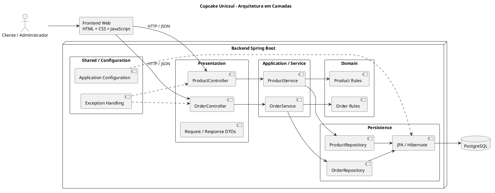
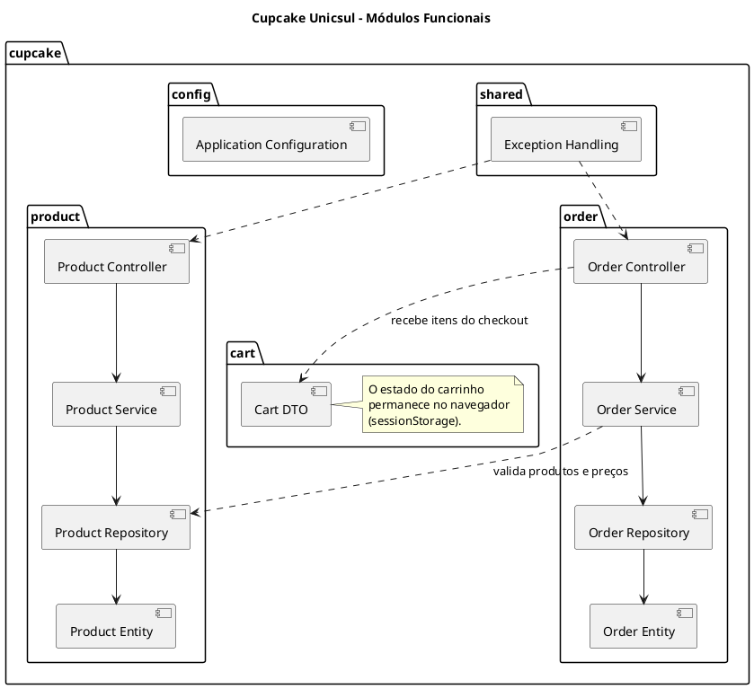

# Fase 3 — Arquitetura
## Projeto Cupcake Unicsul

**Projeto:** `cupcake-unicsul`  
**Group ID:** `io.github.lussac7`  
**Artifact ID:** `cupcake`  
**Status:** Proposta arquitetural para revisão e aprovação  
**Base tecnológica prevista:** Java 21, Spring Boot 4.x, Maven, PostgreSQL, Spring Data JPA, Hibernate, Flyway, REST API, HTML, CSS e JavaScript vanilla.

---

## 1. Objetivo da fase

Definir uma arquitetura simples, compreensível e adequada ao escopo acadêmico da loja de cupcakes.

Esta fase estabelece:

- estilo arquitetural;
- módulos e pacotes;
- responsabilidades das camadas;
- regras de dependência;
- infraestrutura e configuração;
- tratamento de erros;
- segurança dentro das limitações aprovadas;
- estratégia inicial de testes;
- diagramas PlantUML.

Não serão criados código Java, entidades JPA, tabelas ou endpoints nesta fase.

## 2. Estilo arquitetural

Adotar **Monólito Modular + Arquitetura em Camadas**.

A aplicação será implantada como uma única unidade Spring Boot. Internamente, o código será separado por módulos funcionais e camadas.

### 2.1 Justificativa

- O domínio é pequeno e possui poucos módulos.
- A implantação de uma única aplicação reduz a complexidade operacional.
- A separação por camadas facilita o entendimento e os testes.
- Os módulos funcionais mantêm produtos, carrinho e pedidos organizados.
- A solução permite evolução sem introduzir microsserviços ou infraestrutura distribuída.

### 2.2 Visão geral

O fluxo principal de uma requisição será:

`Cliente Web → Controller → Service → Domain/Repository → PostgreSQL`

O frontend será uma aplicação simples em HTML, CSS e JavaScript vanilla, separada logicamente do backend e consumindo sua API REST.

## 3. Módulos funcionais

Serão utilizados três módulos funcionais:

| Módulo | Responsabilidade | Casos de uso relacionados |
|---|---|---|
| `product` | Consultar, cadastrar, alterar e desativar cupcakes. | UC-001, UC-002, UC-008, UC-009, UC-010 |
| `cart` | Manter o carrinho temporário no navegador e apresentar quantidades e valores. | UC-003, UC-004, UC-005 |
| `order` | Receber os dados do cliente, validar os itens, registrar pedidos e permitir consultas. | UC-006, UC-007, UC-011 |

**Observação sobre o carrinho:** conforme decisão aprovada na Fase 1, o carrinho será temporário e ficará no navegador, usando armazenamento de sessão (`sessionStorage`). O backend não manterá um carrinho persistente. Ao confirmar um pedido, o frontend enviará os itens e quantidades à API; o backend deverá consultar novamente os produtos e seus preços/disponibilidade, sem confiar nos valores enviados pelo navegador.

## 4. Organização de pacotes

Estrutura proposta para o backend:

```text
src/main/java/io/github/lussac7/cupcake/
├── CupcakeApplication.java
├── product/
│   ├── controller/
│   ├── service/
│   ├── repository/
│   ├── entity/
│   └── dto/
├── cart/
│   └── dto/
├── order/
│   ├── controller/
│   ├── service/
│   ├── repository/
│   ├── entity/
│   └── dto/
├── shared/
│   ├── exception/
│   └── web/
└── config/
```

### 4.1 Responsabilidade dos pacotes

| Pacote | Responsabilidade |
|---|---|
| `product.controller` | Receber requisições HTTP relacionadas a produtos e produzir respostas REST. |
| `product.service` | Executar os casos de uso e coordenar as operações do módulo de produtos. |
| `product.repository` | Acesso aos dados de produtos por meio do Spring Data JPA. |
| `product.entity` | Entidades de persistência do módulo de produtos. |
| `product.dto` | Objetos de entrada e saída da API de produtos. |
| `cart.dto` | Representar os itens enviados pelo frontend para a operação de pedido, sem persistir um carrinho. |
| `order.controller` | Receber requisições de criação e consulta de pedidos. |
| `order.service` | Coordenar validações e o registro/consulta de pedidos. |
| `order.repository` | Acesso aos dados persistidos de pedidos. |
| `order.entity` | Entidades de persistência de pedidos e seus itens. |
| `order.dto` | Objetos de entrada e saída da API de pedidos. |
| `shared.exception` | Exceções e tipos comuns de erro da aplicação. |
| `shared.web` | Componentes web compartilhados, como a representação padronizada de erros, quando necessário. |
| `config` | Configurações explícitas da aplicação Spring Boot. |

A estrutura é intencionalmente pequena. Não serão criados pacotes vazios nem abstrações genéricas sem necessidade demonstrada.

## 5. Camadas e responsabilidades

### 5.1 Presentation Layer

**Responsabilidade:** interface entre HTTP e a aplicação.

Componentes principais:
- Controllers REST.
- DTOs de requisição e resposta.
- Validação de formato dos dados recebidos.
- Conversão de resultados em respostas HTTP.

Regras:
- Não implementar regras de negócio nos controllers.
- Não acessar repositories diretamente.
- Não retornar entidades JPA ao cliente.
- Não confiar em preço, total ou disponibilidade informados pelo navegador.

### 5.2 Application / Service Layer

**Responsabilidade:** implementar os casos de uso e coordenar o fluxo da aplicação.

Componentes principais:
- `ProductService`.
- `OrderService`.

Responsabilidades:
- Coordenar operações entre repositórios e domínio.
- Aplicar regras de negócio que envolvam diferentes objetos.
- Definir limites transacionais.
- Revalidar preço e disponibilidade dos produtos ao criar um pedido.
- Calcular os valores do pedido no backend.
- Registrar pedido e itens de forma consistente.

Não criar interfaces de serviço para cada classe automaticamente. Uma interface só será introduzida se houver uma necessidade concreta.

### 5.3 Domain Layer

**Responsabilidade:** representar conceitos e regras fundamentais do negócio.

Nesta arquitetura inicial, as entidades de domínio e de persistência poderão ser representadas pelas mesmas classes JPA, desde que isso não comprometa a clareza do modelo.

Regras fundamentais:
- Produto desativado não pode ser incluído em novo pedido.
- Quantidade de item deve ser positiva.
- Pedido deve conter pelo menos um item.
- Preços e totais devem ser calculados e validados no backend.
- O pedido deve preservar snapshots do nome e do preço unitário dos produtos no momento da compra.
- A desativação de produto não deve apagar o histórico de pedidos.

A modelagem detalhada de entidades, value objects, agregados e invariantes será realizada na Fase 4.

### 5.4 Persistence Layer

**Responsabilidade:** persistir e recuperar dados.

Tecnologias:
- Spring Data JPA.
- Hibernate.
- PostgreSQL.
- Flyway para versionamento do esquema.

Responsabilidades:
- Repositórios de produtos e pedidos.
- Mapeamento objeto-relacional.
- Consultas necessárias aos casos de uso.
- Persistência transacional de pedido e itens.

Regras:
- Controllers não acessam a camada de persistência diretamente.
- Services utilizam repositories para acessar dados.
- Consultas devem buscar somente os dados necessários.
- O esquema do banco será controlado por migrações Flyway; não será criado automaticamente pelo Hibernate em produção.

### 5.5 Infrastructure e Configuration

A infraestrutura reúne integrações técnicas e configurações necessárias para executar a aplicação.

Nesta aplicação, inclui:
- configuração do datasource PostgreSQL;
- configuração JPA/Hibernate;
- configuração Flyway;
- configuração de logging;
- tratamento global de exceções HTTP;
- classe principal Spring Boot.

Não será criado um módulo de infraestrutura independente neste primeiro momento. O pacote `config` e os componentes compartilhados atendem ao tamanho atual do sistema.

## 6. Regras de dependência

As dependências devem seguir o sentido abaixo:

1. Controllers dependem dos Services e DTOs.
2. Services dependem das regras de domínio e dos Repositories.
3. Repositories dependem do mecanismo de persistência (Spring Data JPA).
4. Entidades de domínio não devem depender de Controllers.
5. A camada de domínio não deve depender de detalhes HTTP.
6. DTOs são usados nas fronteiras da API; entidades JPA não são expostas diretamente.
7. Configurações técnicas ficam fora das regras de negócio.
8. O módulo `cart` não terá repositório nem entidade persistente, pois o carrinho fica no navegador.

Para manter o projeto simples, não será introduzida uma arquitetura hexagonal completa com portas e adaptadores para todos os componentes.

## 7. Diagrama de arquitetura em camadas

Arquivo sugerido: `docs/uml/03-arquitetura-camadas.puml`



## 8. Diagrama de módulos funcionais

Arquivo sugerido: `docs/uml/03-modulos.puml`



## 9. Infraestrutura e configuração

A aplicação será executada como um único processo Spring Boot e utilizará PostgreSQL como banco de dados.

Decisões:
- Maven será o sistema de build.
- Java 21 será a versão de compilação e execução.
- Spring Boot 4.x gerenciará versões compatíveis das dependências.
- Flyway controlará a evolução do esquema do banco.
- Configurações serão separadas por ambiente quando necessário.
- Credenciais e segredos serão fornecidos por variáveis de ambiente, nunca gravados no repositório.
- O frontend consumirá a API REST por HTTP/JSON.
- CORS será configurado somente se a separação de origem entre frontend e backend exigir isso durante a execução.

A configuração concreta será implementada na Fase 7.

## 10. Segurança e limitações conhecidas

O escopo aprovado não inclui login ou autenticação. Portanto:

- Não será implementado Spring Security para autenticação de usuários.
- Endpoints administrativos de cadastro, alteração e desativação de produtos não terão proteção por perfil.
- A consulta de pedidos será feita pelo identificador do pedido, conforme decisão aprovada.
- O identificador do pedido não equivale a autenticação; essa escolha pode permitir acesso indevido a dados pessoais se o identificador for descoberto.
- A limitação será documentada como restrição acadêmica, não como prática recomendada para uma loja real.
- Entradas serão validadas no backend.
- Erros não revelarão stack traces ou detalhes internos.
- Segredos não serão armazenados no código-fonte.

Não adicionar autenticação ou autorização sem uma alteração formal do escopo aprovada pelo usuário.

## 11. Tratamento de erros

A API deverá apresentar respostas de erro consistentes e compreensíveis.

Casos previstos:
- dados de entrada inválidos;
- produto inexistente;
- produto desativado;
- quantidade inválida;
- carrinho/pedido sem itens;
- preço ou disponibilidade alterados antes da confirmação;
- pedido inexistente;
- falha inesperada de persistência ou aplicação.

Diretrizes:
- Controllers não devem conter blocos repetidos de tratamento de exceção.
- Exceções de negócio devem ser traduzidas em respostas HTTP apropriadas.
- Erros de validação devem indicar os campos inválidos.
- Recursos inexistentes devem resultar em HTTP 404.
- Requisições inválidas ou incompatíveis com regras de negócio devem receber status 4xx apropriado.
- Falhas inesperadas devem resultar em resposta genérica HTTP 500, sem expor detalhes internos.
- O formato padronizado de erros será definido na Fase 13.

## 12. Estratégia de testes

Os testes serão desenvolvidos incrementalmente, junto com cada funcionalidade.

| Tipo | Ferramentas | Objetivo |
|---|---|---|
| Unitário | JUnit 5, Mockito | Testar regras e comportamento dos Services sem depender do banco. |
| Web | Spring Boot Test / MockMvc | Testar controllers, validação, status HTTP e contratos JSON. |
| Integração | Spring Boot Test, Testcontainers | Verificar persistência e comportamento real com PostgreSQL. |

Prioridades iniciais:
1. Regras de preço, quantidade, disponibilidade e pedido.
2. Registro transacional de pedido e itens.
3. Endpoints de catálogo e pedidos.
4. Validações de entrada e respostas de erro.

Não será perseguida cobertura percentual arbitrária. Os testes devem verificar comportamentos e regras relevantes.

## 13. Decisões arquiteturais

| ID | Decisão | Justificativa |
|---|---|---|
| ADR-001 | Monólito modular | Adequado ao porte e ao objetivo acadêmico. |
| ADR-002 | Arquitetura em camadas | Facilita separação de responsabilidades e aprendizado. |
| ADR-003 | Três módulos funcionais: product, cart e order | Reflete os principais grupos de casos de uso. |
| ADR-004 | Carrinho mantido no navegador via `sessionStorage` | Decisão confirmada na Fase 1; evita persistência desnecessária. |
| ADR-005 | Pedido e itens persistidos no PostgreSQL | Necessário para preservar o histórico. |
| ADR-006 | Sem autenticação | Restrição explicitamente aprovada para o trabalho acadêmico. |
| ADR-007 | Erros tratados de forma centralizada | Evita respostas inconsistentes e repetição de código. |
| ADR-008 | Testes unitários, web e integração | Verifica regras, API e persistência sem exagerar na quantidade. |
| ADR-009 | Sem portas/adaptadores genéricos em todos os módulos | Evita complexidade que o escopo atual não justifica. |

## 14. Rastreabilidade com as fases anteriores

| Elemento arquitetural | Requisitos / Casos de uso relacionados |
|---|---|
| Módulo `product` | FR-001 a FR-008; UC-001, UC-002, UC-008, UC-009, UC-010 |
| Módulo `cart` no frontend | FR-009 a FR-015; UC-003, UC-004, UC-005 |
| Módulo `order` | FR-016 a FR-027; UC-006, UC-007, UC-011 |
| DTOs e validação | Requisitos de dados do cliente, quantidade e pedido; UC-006 |
| Persistência transacional | Persistência consistente de pedido e itens; UC-006 |
| Tratamento de erros | Fluxos alternativos dos casos de uso |
| Ausência de autenticação | Decisão aprovada na Fase 1 |

## 15. Estrutura documental sugerida

```text
cupcake-unicsul/
└── docs/
    ├── requirements/
    │   └── FASE_1_REQUISITOS_CUPCAKE_UNICSUL.md
    ├── use-cases/
    │   └── FASE_2_CASOS_DE_USO_CUPCAKE_UNICSUL.md
    ├── architecture/
    │   └── FASE_3_ARQUITETURA_CUPCAKE_UNICSUL.md
    └── uml/
        ├── 02-casos-de-uso.puml
        ├── 03-arquitetura-camadas.puml
        └── 03-modulos.puml
```

Os caminhos acima são uma proposta de organização. Os diagramas PlantUML estão incluídos neste documento para que possam ser copiados para arquivos `.puml` posteriormente.

## 16. Resultado e aprovação

A arquitetura proposta define:

- um único backend Spring Boot;
- monólito modular organizado em camadas;
- módulos `product`, `cart` e `order`;
- carrinho temporário no navegador;
- persistência de produtos e pedidos em PostgreSQL;
- DTOs na API;
- regras de negócio no backend;
- ausência de autenticação, conforme escopo aprovado;
- tratamento centralizado de erros;
- testes unitários, web e de integração.

**Fora do escopo desta fase:** código Java, entidades JPA, tabelas SQL, migrações Flyway, endpoints implementados e configuração executável.

**Status:** aguardando revisão e aprovação da Fase 3. Após a aprovação, a próxima etapa será a Fase 4 — Modelo de Domínio.
