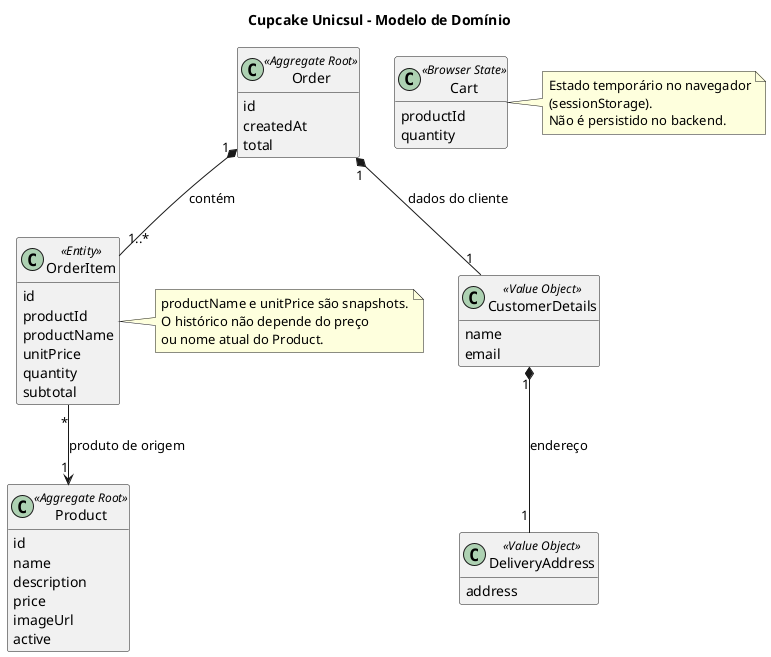
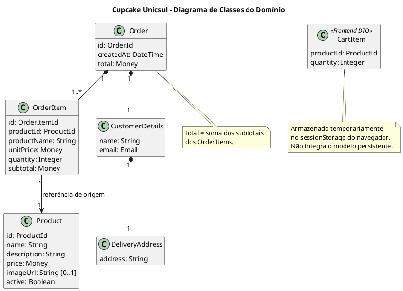

# Fase 4 — Modelo de Domínio
## Projeto Cupcake Unicsul

**Projeto:** `cupcake-unicsul`  
**Group ID:** `io.github.lussac7`  
**Artifact ID:** `cupcake`  
**Status:** Proposta para revisão e aprovação  
**Escopo:** Modelagem conceitual do domínio, sem implementação Java ou JPA.

---

## 1. Objetivo

Identificar os conceitos centrais do negócio e suas regras:

- entidades;
- objetos de valor (Value Objects);
- agregados e raízes de agregado;
- relacionamentos e cardinalidades;
- invariantes e regras de negócio;
- estados e transições relevantes.

A modelagem segue as decisões aprovadas nas Fases 1, 2 e 3. A aplicação permanece pequena: catálogo de cupcakes, carrinho temporário no navegador e registro/consulta de pedidos.

## 2. Escopo do domínio

O domínio persistente contém dois conceitos principais:

1. **Produto:** representa um cupcake oferecido pela loja.
2. **Pedido:** representa uma solicitação de compra confirmada pelo cliente, incluindo os dados necessários para atendimento e os itens comprados.

O carrinho não será uma entidade persistente do backend. Seu estado ficará no navegador, em `sessionStorage`. Durante a confirmação, o frontend enviará ao backend os identificadores dos produtos e as quantidades desejadas.

O backend consultará os produtos, verificará disponibilidade e preço e calculará os valores do pedido. Não confiará em preços ou totais enviados pelo navegador.

Não haverá, nesta versão:
- conta ou cadastro persistente de cliente;
- pagamento online;
- estoque complexo;
- categoria de produto;
- cupons ou descontos;
- gestão de entrega ou rastreamento;
- cancelamento de pedido, pois não existe caso de uso aprovado para isso.

## 3. Entidades

### 3.1 Product

Representa um cupcake oferecido no catálogo.

| Atributo | Tipo conceitual | Obrigatório | Descrição |
|---|---|---:|---|
| `id` | Identificador | Sim | Identificador único do produto. |
| `name` | Texto | Sim | Nome do cupcake. |
| `description` | Texto | Sim | Descrição do produto. |
| `price` | Valor monetário | Sim | Preço atual, estritamente maior que zero. |
| `imageUrl` | Texto/URL | Não | Referência opcional à imagem. |
| `active` | Booleano | Sim | Indica se o produto está disponível para novas compras. |

**Responsabilidades:**
- representar os dados do produto;
- preservar sua identidade;
- indicar se está ativo para venda;
- permitir alteração dos dados de catálogo conforme os casos de uso administrativos.

**Invariantes:**
- `name` não pode ser vazio;
- `price` deve ser maior que zero;
- produto inativo não pode ser incluído em novo pedido;
- desativar um produto não apaga pedidos anteriores.

Atributos de auditoria, como data de criação e atualização, serão avaliados na Fase 5 (Banco de Dados), não sendo acrescentados ao modelo conceitual sem necessidade.

### 3.2 Order

Representa um pedido confirmado pelo cliente.

| Atributo | Tipo conceitual | Obrigatório | Descrição |
|---|---|---:|---|
| `id` | Identificador | Sim | Identificador único do pedido. |
| `customerName` | Texto | Sim | Nome informado pelo cliente no checkout. |
| `customerEmail` | E-mail | Sim | E-mail informado pelo cliente. |
| `deliveryAddress` | Endereço | Sim | Endereço informado para entrega. |
| `createdAt` | Data/hora | Sim | Instante de registro do pedido. |
| `total` | Valor monetário | Sim | Total calculado pelo backend a partir dos itens. |

**Responsabilidades:**
- representar a compra confirmada;
- manter os dados informados pelo cliente no momento da compra;
- conter os itens do pedido;
- preservar o total calculado no momento da confirmação;
- permitir consulta pelo identificador.

**Invariantes:**
- pedido deve conter pelo menos um item;
- dados obrigatórios do cliente devem ser válidos;
- total deve corresponder à soma dos subtotais dos itens;
- pedido confirmado não deve depender dos dados atuais do catálogo para preservar seu histórico.

Não foi definido um fluxo de cancelamento nem outros estados operacionais. Portanto, não será introduzido um atributo `status` nesta modelagem inicial sem requisito que justifique seus valores e transições.

### 3.3 OrderItem

Representa uma linha de produto dentro de um pedido.

| Atributo | Tipo conceitual | Obrigatório | Descrição |
|---|---|---:|---|
| `id` | Identificador | Sim | Identificador do item, se necessário à persistência. |
| `productId` | Referência | Sim | Referência ao produto de origem. |
| `productName` | Texto | Sim | Snapshot do nome no momento da compra. |
| `unitPrice` | Valor monetário | Sim | Snapshot do preço unitário no momento da compra. |
| `quantity` | Inteiro | Sim | Quantidade comprada, maior que zero. |
| `subtotal` | Valor monetário derivado | Sim | `unitPrice × quantity`. |

**Responsabilidades:**
- registrar o produto comprado e sua quantidade;
- preservar o nome e o preço praticados no momento da compra;
- calcular o subtotal da linha.

**Invariantes:**
- `quantity > 0`;
- `unitPrice > 0`;
- `subtotal = unitPrice × quantity`;
- depois de confirmado o pedido, os snapshots não devem ser alterados por mudanças posteriores no produto.

`productId` é uma referência histórica ao produto de origem. O nome e o preço do item são armazenados como snapshots; não devem ser obtidos dinamicamente do catálogo para exibir um pedido antigo.

## 4. Value Objects

### 4.1 CustomerDetails

Agrupa os dados do cliente fornecidos para um pedido:

- `name`;
- `email`;
- `deliveryAddress`.

É um objeto de valor pertencente ao contexto do pedido, não uma entidade independente. Não existe cadastro de cliente nesta versão.

### 4.2 DeliveryAddress

Representa o endereço de entrega informado no checkout.

Nesta fase, o requisito aprovado especifica apenas que o cliente deve informar um endereço. A decomposição em logradouro, número, complemento, bairro, cidade, estado e CEP ainda não foi definida.

Para não inventar campos nem ampliar o escopo, o modelo conceitual representa o endereço como um valor obrigatório. O formato detalhado deverá ser decidido antes da implementação dos DTOs e do banco, caso seja necessário.

### 4.3 Money

Preço, preço unitário, subtotal e total são valores monetários.

Regras:
- valores monetários não devem usar ponto flutuante binário (`float` ou `double`) na implementação;
- a implementação Java deverá usar `BigDecimal`;
- moeda do projeto: Real brasileiro (BRL);
- a escala e as regras de arredondamento serão definidas de maneira consistente na implementação e no esquema do banco.

Não é necessário criar uma classe Java `Money` nesta aplicação acadêmica se `BigDecimal` e validações explícitas forem suficientes. O conceito é tratado aqui como Value Object do domínio.

## 5. Agregados e raízes

### 5.1 Agregado Product

**Raiz:** `Product`

O produto é um agregado simples e independente. Não há outros objetos que precisem ser carregados ou alterados junto com ele no modelo atual.

Operações principais:
- cadastrar;
- alterar;
- desativar;
- consultar.

### 5.2 Agregado Order

**Raiz:** `Order`

`OrderItem` pertence ao agregado `Order`. Um item não existe como compra independente de um pedido.

Operações principais:
- criar pedido com seus itens;
- calcular total;
- consultar pedido e itens.

A criação do pedido e a gravação de seus itens devem ocorrer na mesma transação. Se a gravação de qualquer item falhar, o pedido não deve ficar parcialmente registrado.

Após a confirmação, o pedido e seus snapshots devem ser tratados como histórico. Não há caso de uso aprovado para editar itens ou alterar o total de um pedido confirmado.

### 5.3 Carrinho

O carrinho não é agregado persistente do backend nesta versão.

O navegador mantém uma coleção temporária de identificadores de produtos e quantidades. Os dados do carrinho não são fonte confiável para preço ou disponibilidade. O backend revalida os produtos durante o checkout.

## 6. Relacionamentos e cardinalidades

| Origem | Relacionamento | Destino | Cardinalidade | Observação |
|---|---|---|---|---|
| `Order` | contém | `OrderItem` | 1 para 1..* | Pedido exige pelo menos um item. |
| `OrderItem` | referencia | `Product` | * para 1 | Cada item identifica um produto de origem. |
| `Product` | aparece em | `OrderItem` | 1 para 0..* | Um produto pode nunca ter sido comprado ou aparecer em muitos itens históricos. |
| `Order` | contém dados de | `CustomerDetails` | 1 para 1 | Dados são específicos daquele pedido. |
| `CustomerDetails` | contém | `DeliveryAddress` | 1 para 1 | Endereço obrigatório no checkout. |

**Importante:** o relacionamento histórico `OrderItem → Product` não significa que o pedido dependa dos dados atuais do produto para exibir o histórico. `productName` e `unitPrice` são snapshots próprios do item.

## 7. Regras de negócio e invariantes consolidados

| ID | Regra |
|---|---|
| BR-001 | Cada produto possui identificador único. |
| BR-002 | Nome do produto não pode ser vazio. |
| BR-003 | Preço do produto deve ser maior que zero. |
| BR-004 | Somente produtos ativos podem ser incluídos em novos pedidos. |
| BR-005 | Quantidade de item deve ser maior que zero. |
| BR-006 | Subtotal do item é preço unitário multiplicado pela quantidade. |
| BR-007 | Pedido deve possuir pelo menos um item. |
| BR-008 | Pedido deve conter nome, e-mail válido e endereço de entrega. |
| BR-009 | Total do pedido é calculado pelo backend. |
| BR-010 | Cada item preserva nome e preço unitário no momento da compra. |
| BR-011 | Alterações posteriores no catálogo não modificam o histórico do pedido. |
| BR-012 | Identificador do pedido deve ser único. |
| BR-013 | Pedido e itens devem ser persistidos de forma consistente e transacional. |
| BR-014 | Disponibilidade e preço devem ser revalidados no checkout. |
| BR-015 | Produto usado em pedido não deve ser apagado fisicamente como parte da operação normal de catálogo; deve ser desativado. |

## 8. Estados e transições

### 8.1 Product

Estados relevantes:

- `ACTIVE`: aparece como disponível no catálogo e pode ser comprado.
- `INACTIVE`: não deve ser oferecido para novas compras.

Transição permitida:

```text
ACTIVE ───────> INACTIVE
```

A reativação não foi explicitamente detalhada nos casos de uso aprovados. O caso de uso de alteração de produto poderá contemplá-la somente se essa regra for confirmada; por ora, não se define uma transição de retorno.

### 8.2 Order

O modelo atual considera o pedido criado quando o cliente confirma e o backend registra com sucesso.

Não serão definidos estados como `PAID`, `SHIPPED`, `CANCELLED` ou `DELIVERED`, pois pagamento, expedição, cancelamento e rastreamento estão fora do escopo.

### 8.3 OrderItem

O item é criado como parte da confirmação do pedido e permanece como registro histórico. Não possui ciclo de vida independente.

## 9. Diagrama de Modelo de Domínio

Arquivo sugerido: `docs/uml/04-modelo-dominio.puml`



## 10. Diagrama de Classes UML

O diagrama abaixo apresenta atributos e relacionamentos com maior detalhe. Ele é conceitual e não define ainda anotações JPA, tipos Java definitivos ou estratégia de chaves.

Arquivo sugerido: `docs/uml/04-classes-dominio.puml`



## 11. Decisões e pontos a confirmar

| ID | Tema | Proposta | Motivo |
|---|---|---|---|
| DM-001 | Cliente | Não criar entidade `Customer`; usar `CustomerDetails` como Value Object do pedido. | Não há cadastro de cliente. |
| DM-002 | Endereço | Tratar como valor obrigatório, sem decomposição de campos nesta fase. | O requisito não especifica os componentes do endereço. |
| DM-003 | Imagem | Manter `imageUrl` opcional em `Product`; não criar entidade `ProductImage`. | Uma imagem opcional atende ao requisito atual. |
| DM-004 | Categoria | Não criar entidade `Category`. | Não há requisito aprovado de classificação por categoria. |
| DM-005 | Carrinho | Manter no frontend; não criar entidade JPA ou tabela. | Decisão aprovada na Fase 1. |
| DM-006 | Histórico | Preservar `productName` e `unitPrice` em `OrderItem`. | Evita que mudanças no catálogo alterem pedidos antigos. |
| DM-007 | Status do pedido | Não criar status nesta versão. | Não há fluxo de cancelamento, pagamento ou entrega. |
| DM-008 | Exclusão de produto | Usar desativação lógica (`active = false`). | Preserva referências históricas. |

### Confirmações necessárias

1. **Endereço de entrega:** a proposta é manter um único campo de texto nesta versão acadêmica, sem separar rua, número, complemento, bairro, cidade e CEP. Isso atende ao escopo mínimo e simplifica formulário e persistência.
2. **Reativação de produto:** a proposta é permitir que um produto inativo volte a ficar ativo por meio da alteração de produto. Isso é coerente com um campo `active` e evita exclusão/recriação, mas deve ser confirmado como comportamento administrativo.

## 12. Rastreabilidade

| Conceito | Requisitos / casos de uso |
|---|---|
| `Product` | FR-001 a FR-008; UC-001, UC-002, UC-008, UC-009, UC-010 |
| Carrinho no navegador | FR-009 a FR-015; UC-003, UC-004, UC-005 |
| `Order` | FR-016 a FR-027; UC-006, UC-007, UC-011 |
| `OrderItem` e snapshots | BR-006, BR-010, BR-011, BR-013 |
| `CustomerDetails` | FR-017, FR-018; UC-006, UC-012 |
| `DeliveryAddress` | FR-019; UC-006, UC-012 |

## 13. Resultado e aprovação

Esta fase propõe um domínio persistente com três entidades conceituais (`Product`, `Order` e `OrderItem`), dois Value Objects principais (`CustomerDetails` e `DeliveryAddress`) e o conceito monetário `Money`.

O carrinho permanece como estado temporário do frontend e não integra o modelo persistente.

**Ainda não foram criados:** classes Java, entidades JPA, repositórios, tabelas SQL ou migrações Flyway.

**Status:** aguardando revisão e aprovação da Fase 4, especialmente das duas confirmações indicadas na seção 11. Após a aprovação, a próxima etapa será a Fase 5 — Projeto do Banco de Dados.
