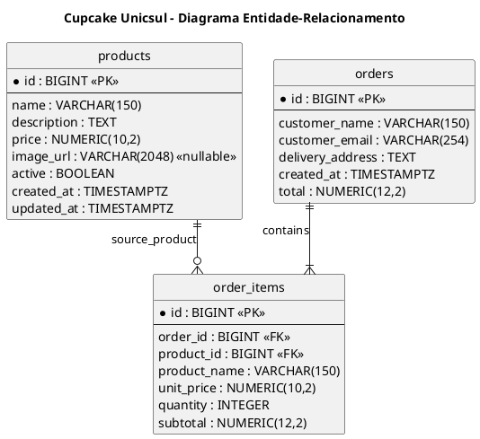

# Fase 5 — Projeto do Banco de Dados
## Projeto Cupcake Unicsul

**Projeto:** `cupcake-unicsul`  
**Group ID:** `io.github.lussac7`  
**Artifact ID:** `cupcake`  
**Banco:** PostgreSQL  
**Status:** Proposta para revisão e aprovação  
**Base:** Modelo de Domínio aprovado na Fase 4.

---

## 1. Objetivo

Converter o modelo de domínio em um esquema relacional simples, definindo:

- tabelas e colunas;
- tipos de dados PostgreSQL;
- chaves primárias e estrangeiras;
- restrições `UNIQUE` e `CHECK`;
- índices;
- relacionamentos;
- timestamps e campos de auditoria justificados;
- estratégia de migrações com Flyway.

Esta fase documenta o projeto do banco. A migração SQL executável será criada na Fase 8, depois do bootstrap e da configuração da aplicação.

## 2. Decisões aprovadas da Fase 4

O esquema considera as seguintes decisões:

- `Product`, `Order` e `OrderItem` são as entidades persistentes.
- `OrderItem` pertence a `Order`.
- Cada item preserva o nome e o preço unitário do produto no momento da compra.
- O carrinho permanece no navegador, em `sessionStorage`.
- Os dados do cliente são registrados no próprio pedido; não haverá tabela `customers`.
- O endereço de entrega será armazenado em um único campo de texto.
- Um produto pode ser desativado e posteriormente reativado.
- Produtos não serão apagados fisicamente pela operação normal de catálogo.
- Não haverá pagamento online nem status operacional de pedido nesta versão.

## 3. Visão geral do esquema

Serão criadas somente três tabelas:

| Tabela | Finalidade |
|---|---|
| `products` | Cadastro e disponibilidade dos cupcakes. |
| `orders` | Dados do cliente e informações gerais do pedido. |
| `order_items` | Itens do pedido, incluindo snapshots de nome e preço. |

### 3.1 Diagrama ER

Arquivo sugerido: `docs/uml/05-modelo-er.puml`



Interpretação:

- Um pedido contém um ou mais itens.
- Cada item pertence a exatamente um pedido.
- Um item referencia um produto de origem.
- Um produto pode não ter sido comprado ou pode estar associado a vários itens históricos.
- O nome e o preço copiados para `order_items` preservam o histórico mesmo que o produto seja alterado posteriormente.

## 4. Definição das tabelas

### 4.1 Tabela `products`

Armazena os cupcakes disponíveis no catálogo.

| Coluna | Tipo PostgreSQL | Nulo? | Regra / finalidade |
|---|---|---:|---|
| `id` | `BIGINT GENERATED BY DEFAULT AS IDENTITY` | Não | Chave primária. |
| `name` | `VARCHAR(150)` | Não | Nome do produto; não pode ser vazio após remoção de espaços nas extremidades. |
| `description` | `TEXT` | Não | Descrição do produto. |
| `price` | `NUMERIC(10,2)` | Não | Preço atual, maior que zero. |
| `image_url` | `VARCHAR(2048)` | Sim | URL opcional da imagem. |
| `active` | `BOOLEAN` | Não | Disponibilidade para novas compras; padrão `TRUE`. |
| `created_at` | `TIMESTAMPTZ` | Não | Data/hora de criação; padrão `CURRENT_TIMESTAMP`. |
| `updated_at` | `TIMESTAMPTZ` | Não | Data/hora da última atualização; padrão `CURRENT_TIMESTAMP`. |

**Restrições:**

- `PRIMARY KEY (id)`.
- `CHECK (price > 0)`.
- `CHECK (length(trim(name)) > 0)`.
- `CHECK (length(trim(description)) > 0)`.
- `active DEFAULT TRUE`.
- `created_at DEFAULT CURRENT_TIMESTAMP`.
- `updated_at DEFAULT CURRENT_TIMESTAMP`.

**Auditoria:** `created_at` e `updated_at` são úteis porque o administrador pode cadastrar e alterar produtos. O valor de `updated_at` deverá ser atualizado pela aplicação quando os dados do produto forem modificados; o default do banco só cobre a inserção.

Não será adicionada unicidade ao nome do produto, pois o domínio não exige nomes exclusivos.

### 4.2 Tabela `orders`

Armazena os dados do pedido e os dados de contato/entrega informados pelo cliente.

| Coluna | Tipo PostgreSQL | Nulo? | Regra / finalidade |
|---|---|---:|---|
| `id` | `BIGINT GENERATED BY DEFAULT AS IDENTITY` | Não | Chave primária e identificador do pedido. |
| `customer_name` | `VARCHAR(150)` | Não | Nome informado no checkout. |
| `customer_email` | `VARCHAR(254)` | Não | E-mail informado no checkout. |
| `delivery_address` | `TEXT` | Não | Endereço de entrega em um único campo. |
| `created_at` | `TIMESTAMPTZ` | Não | Instante de criação do pedido. |
| `total` | `NUMERIC(12,2)` | Não | Total calculado pelo backend no momento da confirmação. |

**Restrições:**

- `PRIMARY KEY (id)`.
- Nome, e-mail e endereço não podem ser vazios após remoção de espaços nas extremidades.
- `CHECK (total > 0)`.
- `created_at DEFAULT CURRENT_TIMESTAMP`.

A validação completa do formato do e-mail será feita na aplicação. Uma restrição SQL simples não substitui a validação apropriada de e-mail.

Não haverá `customer_id`, pois não existe cadastro persistente de clientes.

Não haverá coluna `status`, pois esta versão não possui fluxos de pagamento, expedição ou cancelamento.

Não haverá `updated_at`: um pedido confirmado representa um registro histórico e não possui operação de edição aprovada.

### 4.3 Tabela `order_items`

Armazena os produtos e quantidades que compõem um pedido.

| Coluna | Tipo PostgreSQL | Nulo? | Regra / finalidade |
|---|---|---:|---|
| `id` | `BIGINT GENERATED BY DEFAULT AS IDENTITY` | Não | Chave primária. |
| `order_id` | `BIGINT` | Não | Chave estrangeira para `orders.id`. |
| `product_id` | `BIGINT` | Não | Chave estrangeira para `products.id`. |
| `product_name` | `VARCHAR(150)` | Não | Snapshot do nome no momento da compra. |
| `unit_price` | `NUMERIC(10,2)` | Não | Snapshot do preço unitário no momento da compra. |
| `quantity` | `INTEGER` | Não | Quantidade comprada, maior que zero. |
| `subtotal` | `NUMERIC(12,2)` | Não | Subtotal calculado pelo backend. |

**Restrições:**

- `PRIMARY KEY (id)`.
- `FOREIGN KEY (order_id) REFERENCES orders(id)`.
- `FOREIGN KEY (product_id) REFERENCES products(id)`.
- `CHECK (length(trim(product_name)) > 0)`.
- `CHECK (unit_price > 0)`.
- `CHECK (quantity > 0)`.
- `CHECK (subtotal = unit_price * quantity)`.
- `UNIQUE (order_id, product_id)`.

A restrição `UNIQUE (order_id, product_id)` impede duas linhas para o mesmo produto dentro de um pedido. O backend deverá consolidar quantidades repetidas do mesmo produto antes de persistir os itens.

**Snapshots:** `product_name` e `unit_price` são copiados para o item no momento da compra. Consultas históricas devem usar esses valores, e não o nome/preço atual de `products`.

**Integridade referencial:** a FK para `products` não deverá permitir exclusão física de um produto que já esteja referenciado por um item de pedido. A aplicação utilizará a desativação lógica (`active = FALSE`).

## 5. Tipos monetários e precisão

Todos os valores monetários serão armazenados com `NUMERIC`, nunca com tipos de ponto flutuante.

| Campo | Tipo | Justificativa |
|---|---|---|
| `products.price` | `NUMERIC(10,2)` | Preço unitário atual do produto. |
| `order_items.unit_price` | `NUMERIC(10,2)` | Snapshot do preço unitário. |
| `order_items.subtotal` | `NUMERIC(12,2)` | Resultado de preço multiplicado por quantidade. |
| `orders.total` | `NUMERIC(12,2)` | Soma dos subtotais do pedido. |

Moeda do sistema: Real brasileiro (BRL).

Na aplicação Java, a representação monetária será feita com `BigDecimal`. O backend calculará subtotais e total; os valores enviados pelo frontend não serão aceitos como fonte de verdade.

A igualdade `orders.total = SUM(order_items.subtotal)` é uma regra entre linhas/tabelas. Ela será garantida pelo serviço de aplicação dentro da transação de criação do pedido e coberta por testes; um `CHECK` comum não pode validar diretamente a soma de outras linhas.

## 6. Chaves e relacionamentos

| Tabela/coluna | Tipo | Referência | Regra |
|---|---|---|---|
| `products.id` | PK | — | Identificador do produto. |
| `orders.id` | PK | — | Identificador do pedido. |
| `order_items.id` | PK | — | Identificador do item. |
| `order_items.order_id` | FK | `orders.id` | Item deve pertencer a um pedido existente. |
| `order_items.product_id` | FK | `products.id` | Item deve referenciar produto existente. |

Cardinalidades:

- `orders` 1 — N `order_items`, com pelo menos um item por pedido completo.
- `products` 1 — N `order_items`, sendo possível um produto não possuir itens históricos.

**Nota sobre pedido com pelo menos um item:** o relacionamento exige ao menos um item no modelo de domínio. A criação das linhas de pedido será realizada em uma única transação. A garantia de que um pedido nunca seja confirmado sem itens será aplicada pelo serviço antes do commit e coberta por testes. Não será adicionada uma trigger nesta aplicação acadêmica.

## 7. Índices

Índices propostos:

| Índice | Coluna(s) | Finalidade |
|---|---|---|
| PK de `products` | `id` | Busca de produto por identificador. |
| PK de `orders` | `id` | Consulta de pedido por identificador. |
| PK de `order_items` | `id` | Identificação do item. |
| Índice parcial em `products` | `name WHERE active = TRUE` | Apoiar listagem/ordenação do catálogo ativo por nome. |
| Índice em `order_items` | `order_id` | Recuperar os itens de um pedido. |
| Índice em `order_items` | `product_id` | Apoiar consultas/restrições envolvendo produto de origem. |
| Índice em `orders` | `created_at` | Apoiar consulta e ordenação de pedidos por data. |

Observações:

- Chaves primárias e restrições `UNIQUE` já criam índices no PostgreSQL.
- A restrição `UNIQUE (order_id, product_id)` cria índice composto e começa por `order_id`; um índice adicional isolado em `order_id` provavelmente será redundante. Portanto, não será criado índice separado para `order_id`.
- A necessidade do índice em `product_id` será mantida para apoiar a FK e consultas por produto.
- Não serão criados índices especulativos para campos de texto sem requisito de pesquisa correspondente.
- Os índices poderão ser revistos se consultas reais demonstrarem necessidade.

## 8. SQL conceitual proposto

O trecho abaixo documenta a estrutura pretendida. Ele **não é ainda o arquivo de migração Flyway**.

```sql
CREATE TABLE products (
    id BIGINT GENERATED BY DEFAULT AS IDENTITY PRIMARY KEY,
    name VARCHAR(150) NOT NULL,
    description TEXT NOT NULL,
    price NUMERIC(10, 2) NOT NULL,
    image_url VARCHAR(2048),
    active BOOLEAN NOT NULL DEFAULT TRUE,
    created_at TIMESTAMPTZ NOT NULL DEFAULT CURRENT_TIMESTAMP,
    updated_at TIMESTAMPTZ NOT NULL DEFAULT CURRENT_TIMESTAMP,

    CONSTRAINT ck_products_name_not_blank
        CHECK (length(trim(name)) > 0),

    CONSTRAINT ck_products_description_not_blank
        CHECK (length(trim(description)) > 0),

    CONSTRAINT ck_products_price_positive
        CHECK (price > 0)
);

CREATE TABLE orders (
    id BIGINT GENERATED BY DEFAULT AS IDENTITY PRIMARY KEY,
    customer_name VARCHAR(150) NOT NULL,
    customer_email VARCHAR(254) NOT NULL,
    delivery_address TEXT NOT NULL,
    created_at TIMESTAMPTZ NOT NULL DEFAULT CURRENT_TIMESTAMP,
    total NUMERIC(12, 2) NOT NULL,

    CONSTRAINT ck_orders_customer_name_not_blank
        CHECK (length(trim(customer_name)) > 0),

    CONSTRAINT ck_orders_customer_email_not_blank
        CHECK (length(trim(customer_email)) > 0),

    CONSTRAINT ck_orders_delivery_address_not_blank
        CHECK (length(trim(delivery_address)) > 0),

    CONSTRAINT ck_orders_total_positive
        CHECK (total > 0)
);

CREATE TABLE order_items (
    id BIGINT GENERATED BY DEFAULT AS IDENTITY PRIMARY KEY,
    order_id BIGINT NOT NULL,
    product_id BIGINT NOT NULL,
    product_name VARCHAR(150) NOT NULL,
    unit_price NUMERIC(10, 2) NOT NULL,
    quantity INTEGER NOT NULL,
    subtotal NUMERIC(12, 2) NOT NULL,

    CONSTRAINT fk_order_items_order
        FOREIGN KEY (order_id)
        REFERENCES orders (id)
        ON DELETE RESTRICT,

    CONSTRAINT fk_order_items_product
        FOREIGN KEY (product_id)
        REFERENCES products (id)
        ON DELETE RESTRICT,

    CONSTRAINT uq_order_items_order_product
        UNIQUE (order_id, product_id),

    CONSTRAINT ck_order_items_product_name_not_blank
        CHECK (length(trim(product_name)) > 0),

    CONSTRAINT ck_order_items_unit_price_positive
        CHECK (unit_price > 0),

    CONSTRAINT ck_order_items_quantity_positive
        CHECK (quantity > 0),

    CONSTRAINT ck_order_items_subtotal_consistent
        CHECK (subtotal = unit_price * quantity)
);

CREATE INDEX idx_products_active_name
    ON products (name)
    WHERE active = TRUE;

CREATE INDEX idx_order_items_product_id
    ON order_items (product_id);

CREATE INDEX idx_orders_created_at
    ON orders (created_at);
```

## 9. Estratégia de migrações Flyway

O esquema será versionado com Flyway.

Diretório previsto:

```text
src/main/resources/
├── application.yml
└── db/
    └── migration/
        └── V1__initial_schema.sql
```

Estratégia inicial:

| Versão | Arquivo | Responsabilidade |
|---|---|---|
| V1 | `V1__initial_schema.sql` | Criar `products`, `orders`, `order_items`, constraints e índices iniciais. |

Regras:

1. Migrações versionadas não devem ser editadas depois de aplicadas em um ambiente compartilhado.
2. Alterações futuras serão registradas em novas migrações (`V2`, `V3` etc.).
3. Flyway será responsável pela evolução do esquema.
4. Hibernate não deverá criar ou alterar o esquema automaticamente em produção.
5. A aplicação deverá validar o mapeamento JPA em relação ao esquema existente.
6. Migrações serão verificadas por testes de integração com PostgreSQL via Testcontainers na fase de testes.

A migração `V1__initial_schema.sql` será efetivamente criada na Fase 8.

## 10. Relação com os módulos da aplicação

| Módulo | Tabelas acessadas |
|---|---|
| `product` | `products` |
| `cart` | Nenhuma tabela; estado no navegador. |
| `order` | `orders`, `order_items` e leitura de `products` durante a validação do checkout. |

O módulo de pedidos consulta produtos para verificar se continuam ativos e obter os preços atuais. Em seguida, grava os snapshots em `order_items`.

## 11. Rastreabilidade com requisitos e domínio

| Elemento do banco | Regras / requisitos relacionados |
|---|---|
| `products.active` | BR-004, BR-015; UC-001, UC-008, UC-009, UC-010 |
| `products.price` | BR-003, BR-009, BR-014 |
| `orders` | FR-017 a FR-027; UC-006, UC-007, UC-011 |
| `order_items.quantity` | BR-005 |
| `order_items.subtotal` | BR-006 |
| Snapshots em `order_items` | BR-010, BR-011 |
| FK e transação de pedido | BR-013 |
| `orders.total` | BR-009 |
| `created_at` | Auditoria e ordenação de pedidos |

## 12. Resultado e aprovação

O projeto do banco de dados propõe:

- três tabelas: `products`, `orders` e `order_items`;
- chaves primárias identity;
- chave estrangeira entre itens, pedidos e produtos;
- snapshots do nome e preço do produto;
- valores monetários com `NUMERIC`;
- constraints para proteger invariantes locais;
- índices voltados às consultas previstas;
- timestamps justificados;
- migração inicial versionada com Flyway.

**Fora do escopo desta fase:** criação ou execução da migração, entidades JPA, repositories, código Java, configuração executável do datasource.

**Status:** aguardando revisão e aprovação da Fase 5. Após a aprovação, a próxima etapa será a Fase 6 — Bootstrap do Projeto Maven/Spring Boot.
